# Urban Lab „Ekonomija grada“ — Multi-Scale (XS / S / M / L / XL) Arhitektura baza podataka i interfejsa (v2)

**Sesija:** `c1795299369016b6gi`  
**Datum:** `2026-11-22`  
**Opseg:** 5 komparativnih gradova (**Beograd, Zagreb, Sarajevo, Novi Pazar, Travnik**) + **36 opština/gradova njihovih širih funkcionalnih okruženja (L)** + **regionalni/međunarodni koridori i strategije (XL)**  
**Glavna baza:** `curated/urban_lab_5cities.sqlite` (**32,85 MB** · **21 tabela** · **10 analitičkih pogleda**)  
**Prostorni slojevi:** `curated/boundaries/` (**13 WGS84 GeoJSON slojeva**) + `curated/tables/` (**16 CSV tabela**)

---

## 1. Zašto je optimalan okvir **XS / S / M / L / XL** (umesto samo gradske granice)

Administrativna granica grada je veštačka linija za ekonomiju. Ekonomija grada funkcioniše kao **ugnježdeni sistem pet razmera**, gde svaka jedinica nižeg nivoa (npr. jedna zanatska pekara) zavisi od tokova resursa, radne snage, cena i regulative sa svih viših nivoa:

| Skala | Prostorni obuhvat | Šta se meri u bazi | Primer: **Zanatska pekara** | Ključne tabele & GeoJSON slojevi |
|---|---|---|---|---|
| **XS** | **Zgrada / Parcela / Lokal** (`10–200 m²`) | 3D gabarit/spratnost, zakup poslovnog prostora, cena m² po zoni | Lokal od 60 m² u prizemlju, ugovor o zakupu (EUR/m²), peć na drva/struju | `zagreb_commercial_leases` (320), `ZG3D Donji Grad`, `property_zones_prices` (162) |
| **S** | **Mikro-lokacija / Kvart / Radijus hoda** (`200 m – 2 km`) | Konkurencija (pekare u radijusu), pijace, autobuska/tramvajska stajališta, 1 km gustina stanovništva, P&L jedinice | Radijus stalnih mušterija (500–800 m), blizina pijace i škole, 4 radnika, breakeven hlebova/dan | `osm_pois` (**77.330** za 5 gradova), `s_scale_input_costs`, `s_bakery_unit_model`, `s_scale_bakeries_markets_5cities.geojson` (1.469 tačaka), `1km_grid` (BG+NP), `zagreb_markets` (31) |
| **M** | **Grad / Četvrti / Opštine** (`5 – 25 km`) | Gradske opštine/četvrti, konsolidovani budžet i porezi, struktura privrede (NACE + LQ), plate, bid-rent gradijent, javni prevoz O-D | Zonska poreska osnovica, opštinska renta, broj firmi u gradu, gradska potrošačka moć | `cities` (5), `admin_units` (362), `fiscal_budgets` (16), `zagreb_budget_lines` (7.316), `companies_sr` (66.040), `sector_structure` (559), `all_5cities_admin_units.geojson` (45), `zagreb_218_mjesnih_odbora.geojson`, `novi_pazar_99_naselja.geojson`, `o-d-matrica` (308×308) |
| **L** | **Funkcionalna urbana regija / Hinterland** (`15 – 65 km`, okolni gradovi, prigradska naselja i sela) | Dnevne migracije radnika, poljoprivredna baza (pšenica, OPG-ovi), šumarstvo (m³ ogrevnog drveta), satelitske industrijske/logističke zone, prekogranični/među-kantonalni tokovi | Odakle dolaze **drva za peć** (Golija/Tutin, Komar/SBK, Pale/Sokolac, Turopolje), odakle **brašno/mlin** (Srem/Banat, ZŽ/Slavonija, Jelah/ZDK) i odakle dolaze **prigradski radnici i mušterije** | `hinterland_units` (36 opština/gradova), `companies_sr_hinterland` (5.816 APR firmi), `commuting_and_flows` (31), `hinterland_agri_forestry_trade` (7 regija), `all_5cities_hinterland_l.geojson` (35 poligona) |
| **XL** | **Država / Regionalni koridori / Međunarodni kontekst** (`100 – 1.500 km`) | NUTS3 regionalni BDP (EUR i PPS), PDV i poreski klin, cene struje/gasa (Eurostat), doznake iz inostranstva (remittances), spoljna trgovina, TEN-T/WBIF koridori, aerodromi, nacionalne strategije 2021–2035 | Zašto je hleb u ZG na **5% PDV** a u BiH **17%**, zašto je struja u BiH **0,138** a u HR **0,222 EUR/kWh**, kako **Autoput A2 Duga Poljana** ili **Brza cesta Lašva–Travnik** menja cenu dopreme brašna i širi tržište | `xl_regional_gdp_nuts3` (74), `xl_macro_indicators` (357), `macro_worldbank` (120), `xl_corridors_projects_strategies` (11), `xl_strategic_corridors.geojson` (7) |

---

## 2. Logička šema relacione baze (`urban_lab_5cities.sqlite` v2)

```mermaid
erDiagram
    cities ||--o{ admin_units : "M: gradske opstine/cetvrti/naselja"
    cities ||--o{ fiscal_budgets : "M/L: gradski i kantonalni budzeti"
    cities ||--o{ property_zones_prices : "XS/M: poreske zone i RCN cene"
    cities ||--o{ sector_structure : "M: NACE sektori i LQ"
    cities ||--o{ osm_pois : "S/M/L: 77.330 POI i transport"
    cities ||--|| s_scale_input_costs : "S/XL: struja, brasno, drvo, rad, PDV"
    cities ||--|| s_bakery_unit_model : "S: uporedni P&L pekare"
    cities ||--o{ hinterland_units : "L: 36 okolnih gradova i opstina"
    cities ||--o{ commuting_and_flows : "L->M: dnevne migracije i O-D"
    cities ||--o{ hinterland_agri_forestry_trade : "L: psenica, ogrevno drvo, izvoz/uvoz, turizam"
    cities ||--o{ xl_regional_gdp_nuts3 : "XL: Eurostat NUTS3 BDP"
    cities ||--o{ companies_sr : "M: 66.040 APR firmi + RGFI"
    cities ||--o{ companies_sr_hinterland : "L: 5.816 APR firmi u prstenu"
    cities ||--o{ zagreb_budget_lines : "M: 7.316 stavki proracuna ZG"
    cities ||--o{ zagreb_commercial_leases : "XS: 320 ugovora zakupa ZG"
    cities ||--o{ zagreb_markets : "S: 31 pijaca ZG"
```

### Ključ za povezivanje svih tabela (`Join Keys`)
- **Primarni ključ grada (`city_id`):** `'beograd'`, `'zagreb'`, `'sarajevo'`, `'novi_pazar'`, `'travnik'` — prisutan u svakoj tabeli (ili kao `city_hub` u L/XL tabelama), što omogućava **trenutno paralelno poređenje 2 do 5 gradova jednim SQL upitom**.
- **Državni ključ (`country_iso` / `country_iso3`):** `'SRB'`, `'HRV'`, `'BIH'` — povezuje gradove sa `macro_worldbank`, `xl_macro_indicators` i `s_scale_input_costs`.
- **Prostorni ključ (WGS84 `lat`, `lon` + `unit_code` / `unit_id`):** svi GeoJSON fajlovi su standardizovani u **EPSG:4326 (WGS84)** i direktno se spajaju sa SQLite tabelama preko `city_id`, `unit_code` i `unit_id`.
- **Revizorski trag (`sources_manifest`):** **175** verifikovanih zapisa sa URL-om, HTTP statusom, veličinom i SHA-256 hešom izvornog fajla.

---

## 3. Empirijski dokaz S ↔ M ↔ L ↔ XL veza: primer „Pekara“ u 5 gradova

Referentna zanatska pekara: **60 m² lokal**, **4 radnika** (1,20× minimalna bruto zarada + trošak poslodavca), **220 kg brašna/dan** (6.600 kg/mes), **12 prm ogrevnog drveta/mes** (peć na drva) + **1.800 kWh struje/mes** (Eurostat `nrg_pc_205` 2026-S1, bez PDV).

| Grad | Brašno (EUR/kg) | Drvo (EUR/prm) | Struja (EUR/kWh) | Mesečni trošak (EUR) | PDV hleb | Cena 500g (EUR) | **Breakeven hlebova/dan** | OSM pekara u regiji | Geografski otisak snabdevanja (S → L → XL) |
|---|---:|---:|---:|---:|---:|---:|---:|---:|---|
| **Zagreb** | 0,40 | 75 | **0,222** | **11.840** | **5%** | 1,45 | **286** | 426 | Rad (50% troška!) najskuplji; sniženi PDV 5% i visoka kupovna moć spuštaju breakeven. Zaleđe: 11.056 OPG u ZŽ + Slavonija. |
| **Sarajevo** | **0,55** | 56 | **0,138** | **10.706** | **17%** | 1,02 | **410** | 134 | KS proizvodi tek **592 t pšenice (1,4% potreba)** → skupo uvozno brašno (34% troška) + PDV 17%. Drvo: L-prsten (Pale/Sokolac/SBK). |
| **Travnik** | **0,55** | **45** | **0,138** | **10.130** | **17%** | 0,92 | **430** | 26 | Najjeftiniji zakup (540 EUR) i drvo (**115.000 m³** ogrevnog drveta u SBK!), ali skupo brašno i 17% PDV drže visok breakeven. |
| **Beograd** | **0,29** | 78 | 0,156 | **8.887** | 10% | 0,70 | **466** | 575 | Najjeftinije brašno (249 žito firmi + 38 mlinova u BG+Srem/Banat prstenu!), ali skupa drva i niska cena osnovnog hleba teraju na volumen/peciva. |
| **Novi Pazar** | 0,33 | **52** | 0,156 | **8.590** | 10% | 0,65 | **485** | 9* | Drvo lokalno (Golija/Tutin), ali NP+prsten ima samo **5 žito firmi i 2 mlina** → brašno stiže drumom iz Vojvodine; niska cena hleba zahteva visok obrt (485/dan) ili prelazak na burek/mantije. |

*\*Novi Pazar ima samo 9 pekara mapiranih u OSM (naspram 6 d.o.o. u APR + desetine preduzetničkih radnji) — direktan signal gde terensko mapiranje / `NoviPazarFieldGIS` dopunjava otvorene mape.*

---

## 4. Šira funkcionalna okruženja (L) i XL makro-slika — ključni nalazi iz baze v2

### A. Kako 5 gradova komunicira sa svojim okruženjem (L-nivo)
1. **Beograd (L-prsten = +468.336 st. u 7 opština + 7 prigradskih opština BG):**
   - Dnevne migracije (RZS Popis 2022): **166.942** unutar BG regiona + ogroman spoljni priliv iz **Pančeva (10.866 dnevnih migranata u drugu oblast)**, **Stare Pazove (6.356)**, **Inđije (2.391)**, **Rume (1.952)** i **Pećinaca (1.496)**.
   - Srem i Banat čine logističko-prehrambeni motor: **Pećinci (1.895 firmi, 5 mlinova, 36 žito)** i **Inđija (1.376 firmi, 69 žito)** direktno opslužuju Beograd na Koridoru X.
2. **Zagreb (Eurostat FUA = 1.225.505 st. vs 767.131 u Gradu):**
   - **Zagrebačka županija** ima **6.026 M EUR BDP-a (19.500 EUR/st)**, **11.867 poduzetnika (14,5 mlrd EUR prihoda, FINA 2024)** i **11.056 OPG-ova** (HR Upisnik 2024).
   - **Dvosmerni tok:** prsten šalje radnike u Zagreb (Velika Gorica, Samobor, Zaprešić, Dugo Selo), dok **Sveta Nedelja** (porezna konkurentnost) i **Velika Gorica** (aerodrom ZAG, 4,72M putnika) povlače radnike i kapital **iz Zagreba u prsten**. O-D matrica beleži **1.484.915 dnevnih putovanja** (308 zona).
3. **Sarajevo (preko entitetske i kantonalne granice!):**
   - Funkcionalna kotlina obuhvata **Kanton Sarajevo** + **Grad Istočno Sarajevo (RS: Istočno Novo Sarajevo, Istočna Ilidža, Pale, Sokolac)** + **ZDK sever (Visoko, Breza, Kakanj)** + **SBK zapad (Kiseljak, Kreševo, Fojnica)**.
   - **Metabolički kontrast (FZS 2025/2026):** Kanton Sarajevo je potrošačko-uslužna metropola (**pokrivenost uvoza izvozom samo 24,4%**, deficit 5,59 mlrd KM; **1,57M turističkih noćenja**; **2,23M avio-putnika**), dok je njegov proizvodno-izvozni prsten **ZDK na 96,9% pokrivenosti uvoza izvozom** (2,13 mlrd KM izvoza) i proizvodi 13× više pšenice od KS (7.796 t vs 592 t)!
4. **Travnik (Lašvanska dolina = policentrični klaster + ZDK veza):**
   - **Travnik** (50.970 st., administrativno-obrazovno-turističko središte, 12.993 zap.) funkcioniše kao **ekonomski blizanac sa Vitezom** (12 km; 25.667 st., **6.956 zap.**, PC 96 trgovačko-industrijski gigant) i **Novim Travnikom** (10 km; 4.560 zap., viša neto plata **1.238 KM** vs Travnik 1.156 KM), uz **Zenicu** (25 km, 27.248 zap.) kao najbliži železnički i Koridor Vc izlaz!
   - **Šumarska baza:** SBK seče **389.000 m³** drveta godišnje (**115.000 m³** ogrevnog drveta lišćara).
5. **Novi Pazar (izolovani trgovačko-logistički čvor koji čeka autoput A2):**
   - Prsten čine **Tutin** (317 APR firmi, drvo/nameštaj/dijaspora), **Sjenica** (Pešterska visoravan — stočarstvo/mlekarstvo, 137 firmi) i **Raška** (19,5 km — najbliža železnica i kapija ka Kopaoniku i Ibarskoj magistrali).
   - **XL regionalni jaz (Eurostat 2023):** Raška oblast (`RS217`) ima **5.800 EUR/st BDP** (**9.500 PPS**), naspram Beograda (**19.300 EUR/st**) i Zagreba (**37.500 EUR/st** — 6,5× više!). **Autoput A2 Požega–Duga Poljana–Boljare (~1,7 mlrd EUR)** menja čitavu gravitaciju ovog prostora.

### B. XL strukturni kontekst 3 države (World Bank 2024/2025)
- **Doznake iz inostranstva (Remittances % BDP, 2025):** **BiH 10,72%** | **HRV 6,90%** | **SRB 6,56%** — kritičan eksterni tok kapitala u lokalne nekretnine i potrošnju (posebno Novi Pazar, Travnik, Sarajevo).
- **Prirodna baza inputa (2024):** Oranice **SRB 29,0%** > HRV 15,2% > **BIH 8,0%** (objašnjava cenu brašna); Šumovitost **BIH 42,2%** > SRB 39,2% > HRV 34,8% (objašnjava cenu ogrevnog drveta).
- **Trgovinska otvorenost (% BDP, 2025):** SRB 112,9% | HRV 101,0% | BIH 95,1%.

---

## 5. Koncept interfejsa: „Urban Lab Multi-Scale Workbench“

Interfejs nije obična GIS mapa sa listom lejerea, već **laboratorija sa 4 ortogonalne ose** nad našom SQLite v2 bazom i 13 GeoJSON slojeva:

### 1. Vertikalni klizač razmere (**Scale Ladder: `XS · S · M · L · XL`**)
- Zumiranje ili klik na dugme razmere **automatski menja i geometriju i aktivne ekonomske modele**:
  - **`XS` (z17–19):** 3D zgrade (ZG3D / OSM 3D), pojedinačni lokali i zakupnine, cena m² po zoni.
  - **`S` (z14–16):** **„Supply Chain X-Ray“** — klik na bilo koju pekaru (iz 1.170 OSM pekara) crta: (a) 500 m / 1 km pešački radijus mušterija preko 1 km popisnog grida, (b) najbliže pijace i konkurentske pekare, (c) **lukove snabdevanja** (zelena linija ka šumama/drvu L, zlatna linija ka mlinovima/žitu L/XL) i otvara **interaktivni P&L kalkulator** za taj grad!
  - **`M` (z11–13):** Gradske opštine/četvrti/MO (`all_5cities_admin_units.geojson`), bid-rent 3D ekstruzija cena nekretnina, NACE Location Quotient (LQ) klasteri, budžet po stanovniku, O-D tokovi.
  - **`L` (z8–10):** **Funkcionalna urbana regija** (`all_5cities_hinterland_l.geojson`, 35 poligona) — lukovi dnevnih migracija (npr. Pančevo → Beograd 10.866; Vitez ↔ Travnik), poljoprivredno-šumski metabolizam (pšenica, ogrevno drvo, OPG-ovi, spoljnotrgovinska pokrivenost KS 24% vs ZDK 97%).
  - **`XL` (z5–7):** **Regionalna makro-mapa Balkana i Centralne Evrope** (`xl_strategic_corridors.geojson`) — TEN-T Koridor X i Vc, A2 Duga Poljana, Brza cesta Lašva–Travnik, aerodromi BEG/ZAG/SJJ, NUTS3 BDP horoplet i doznake iz inostranstva.

### 2. Režim poređenja (**Multi-City Split / Matrix View**)
- **1-grad fokus** ili **2-up / 5-up sinhronizovana kamera** (npr. leva mapa **Beograd** na skali L, desna mapa **Zagreb** ili **Sarajevo** na istoj skali `1:250.000` — identična razmera u kilometrima da se golim okom vidi razlika veličine i gustine!).
- Donja traka uvek prikazuje **uporedni „Scorecard“ za svih 5 gradova** iz `v_city_comparison`, `v_s_bakery_5cities_comparison` i `v_xl_latest_nuts3_gdp`.

### 3. Birač sočiva ekonomskih teorija (**Economic Model Lenses**)
Jednim klikom isti prostor se re-renderuje kroz različite ekonomske modele:
1. **Bid-Rent & Land Value** (3D visina = EUR/m², boja = priuštivost u godinama plate).
2. **Aglomeracija & Specijalizacija (LQ)** (gde je koncentrisana koja delatnost — npr. NP Prevoz LQ=2,99, SA Ilidža Nekretnine LQ=2,27, BG Novi Beograd 31,4 mlrd EUR).
3. **Fiskalni metabolizam** (budžet/st, izvorni porezi vs transferi, institucionalna korekcija Kanton+Grad+Općine).
4. **Urbani metabolizam & Lanac snabdevanja (S→L→XL)** (hrana/pšenica, energija/drvo/struja, radna snaga/dnevne migracije).
5. **„Šta-ako“ simulator scenarija** (npr. *PDV na hleb u BiH padne sa 17% na 5%* → breakeven pekare u Sarajevu odmah pada sa 410 na ~368 hlebova/dan; ili *završi se A2 Duga Poljana* → pad cene transporta brašna u NP i rast dostupnosti tržišta).

### 4. „Dokument kao sloj“ (Provenance Inspector)
- Svaka brojka i poligon na mapi imaju bedž pouzdanosti (`Zvanični registar/API` · `Statistički izveštaj PDF` · `Izvedeni model`) i dugme **„Otvori izvor“** koje vodi direktno na zapis iz `sources_manifest` (tačan URL, naziv dokumenta, stranicu i SHA-256 heš).

### Preporučeni tehnički stek za sledeću fazu (izgradnja prototipa)
- **Mapa & 3D:** `MapLibre GL JS` + `deck.gl` (ArcLayer za S→L→XL tokove i migracije, ColumnLayer/GeoJsonLayer za 3D bid-rent i ZG3D, H3/Grid za 1 km popis).
- **Podaci:** lokalni lagani `Node.js` / `FastAPI` server direktno nad `urban_lab_5cities.sqlite` + statički `curated/boundaries/*.geojson` (ili čak 100% statički bundle sa `sql.js` za trenutno deljenje bez servera!).
