# Urban Lab „Ekonomija grada“ — Dizajn šeme baze v4.1: Trust-Tier, Entiteti, NLP→GIS, Event-Study (`t0`), Izborna geografija i 3D/Parcelarni XS sloj

**Sesija:** `c1795299369016b6gi`  
**Datum:** `2026-11-22`  
**Opseg:** Beograd, Zagreb, Sarajevo, Novi Pazar, Travnik (+ L-prstenovi i XL koridori)  
**Osnova (netaknuta):** `curated/urban_lab_5cities.sqlite` v3 (**26 tabela**, **13 pogleda**, SQLite **3.53.1** sa `FTS5`, `RTREE`, `JSON1`)  
**Artefakti dizajna v4.1:**
- Migracioni DDL (validiran dry-runom nad kopijom v3): `schema_v4/migration_v4.sql` (**29** novih logičkih tabela + **4** virtuelne tabele + **8** analitičkih pogleda)
- JSON Schema ugovor za NLP→GIS, izbore i XS ekstrakciju: `schema_v4/nlp_gis_extraction_contract.schema.json`
- Ovaj dokument: `schema_v4/SCHEMA_V4_NLP_GIS_TRUST_EVENTSTUDY.md`

---

## 1. Cilj i arhitektonska načela v4

Baza v3 čuva **statički skelet** ekonomije pet gradova (popisi, APR bilansi, budžeti, poreske zone, OSM `landuse`). Prelazak na v4 uvodi četiri nova, dinamička sloja — **politiku/tendere, vesti/događaje, nauku/inovacije i nezavisne senzore** — bez rušenja ijedne postojeće v3 tabele.

Pet tvrdih pravila koja su ugrađena direktno u DDL (`CHECK`, `FOREIGN KEY`, generisane kolone i trigere):
1. **Stroga aditivnost nad v3:** svih **26** tabela i **13** pogleda iz v3 ostaju nepromenjeni; v4 se sidri na postojeće ključeve (`cities.city_id`, `sources_manifest.id`, `admin_units.id`, `hinterland_units.unit_id`).
2. **Epistemička monotonost (nema „pranja poverenja“):** nijedan agregat, NLP ekstrakcija ili event-study zaključak ne može tiho dobiti viši `trust_tier` od svog najslabijeg ulaznog izvora bez eksplicitnog ljudskog pečata (`verified_by`, `verified_at`).
3. **Prostorna iskrenost (nema lažnih pinova):** dokument koji pominje „Sarajevo“ ili „Srbiju“ na nivou grada/države **ne sme** da se nacrta kao pin na centralnom trgu (`CHECK` zabranjuje `render_as_pin = 1` za `city_core`, `hinterland_ring`, `country_macro`, `unresolved`).
4. **Pravna i etička higijena:** sistem nikada ne generiše automatske etikete korupcije ili krivice. Beleže se isključivo proverljivi **strukturni indikatori** (`single_bidder_flag`, `value_to_estimate_ratio`), primarni URL i citat; unos fizičkog lica (`person_public_role`) blokiran je na nivou baze bez obaveznog polja `public_interest_basis`.
5. **Nulta zavisnost od SpatiaLite-a:** prostorni indeksi rade u čistom SQLite-u preko nativnog `R-Tree` (`gazetteer_rtree`) + `FTS5` (`gazetteer_fts`, `documents_fts`), pa cela baza ostaje jedan prenosivi `.sqlite` fajl spreman i za Node/Python backend i za `sql.js`.

---

## 2. Logički ER dijagram proširenja v4 (naslonjen na v3)

```mermaid
erDiagram
    cities ||--o{ spatial_gazetteer : "sidro M/S/L mesta"
    spatial_gazetteer ||--o{ gazetteer_aliases : "latin/cirilica/padezi"
    spatial_gazetteer ||--|| gazetteer_rtree : "WGS84 bbox R-Tree"
    gazetteer_aliases ||--|| gazetteer_fts : "FTS5 unicode61"

    trust_tiers ||--o{ source_registry : "default_trust_tier"
    source_registry ||--o{ evidence_documents : "izvor"
    sources_manifest ||--o{ evidence_documents : "SHA-256 trag"
    evidence_documents ||--|| documents_fts : "FTS5 pretraga"

    evidence_documents ||--o{ document_geo_mentions : "NLP->GIS"
    spatial_gazetteer ||--o{ document_geo_mentions : "razresena lokacija"
    evidence_documents ||--o{ document_entity_mentions : "pomenuti akteri"

    entities ||--o{ entity_identifiers : "MB/PIB/OIB/JIB/OpenAlex"
    entities ||--o{ entity_aliases : "varijante naziva"
    entities ||--o{ entity_relations : "vremenski graf veza"
    entities ||--o{ document_entity_mentions : "uloga u dokumentu"

    evidence_documents ||--o| domain_signals_procurement : "tenderi i rizici"
    evidence_documents ||--o| domain_signals_science : "nauka O i U gradu"
    source_registry ||--o{ domain_signals_sensors : "VIIRS/OpenAQ/Ookla/Fiskal"

    urban_events ||--o{ event_evidence_links : "deduplikacija dokaza"
    evidence_documents ||--o{ event_evidence_links : "podrzava dogadjaj"
    urban_events ||--o{ event_locations : "epicentar i prstenovi"
    spatial_gazetteer ||--o{ event_locations : "prostor uticaja"

    urban_events ||--o{ event_studies : "t0 dizajn"
    event_studies ||--o{ event_study_observations : "pre/post x treat/control"
    evidence_documents ||--o{ provenance_claims : "revizija tvrdnji"

    election_cycles ||--o{ polling_stations : "BM (RIK/DIP/CIK)"
    spatial_gazetteer ||--o{ polling_stations : "sidro BM"
    polling_stations ||--o{ election_station_results : "glasovi po listi"
    polling_stations ||--o{ election_station_crosswalk : "mapiranje ciklusa"

    spatial_gazetteer ||--o{ xs_cadastral_parcels : "katastarske parcele"
    xs_cadastral_parcels ||--o{ xs_zoning_envelopes : "GUP/PDR/ISPU max FAR"
    xs_cadastral_parcels ||--o{ xs_buildings_3d : "3D objekti"
    xs_buildings_3d ||--|| xs_buildings_rtree : "3D viewport R-Tree"
    xs_cadastral_parcels ||--o{ xs_building_permits : "CEOP/ISPU dozvole"
```



---

## 3. Stub I — `trust_tier` sistem i epistemička higijena

Umesto grubih 3 nivoa, v4 uvodi **5 preciznih kodova u tabeli `trust_tiers`** (razdvajajući mašinski registar/senzor od statičnog PDF izveštaja, i izdvajajući sve izvedene modele/LLM zaključke u `D`):

| `tier_code` | Rang | Naziv | Primeri izvora | Dozvoljen kao kauzalni baseline? | Vizuelni ugovor u MapLibre / deck.gl |
|---|---:|---|---|---:|---|
| **`A1`** | 1 | Primarni registar / zakon / fizički senzor | APR API, `open.ejn.gov.ba`, ISPU, Fiskalizacija RH, Sl. list, VIIRS, OpenAQ, Ookla, GTFS | **Da** | Puna ispuna, oštra ivica (`opacity 0.90`), pun bedž |
| **`A2`** | 2 | Zvanična statistika / publikovani izveštaj | RZS/DZS/FZS godišnjaci i popisi, Eurostat, World Bank, budžeti PDF/XLS | **Da** | Puna ispuna, meka ivica (`opacity 0.85`), oznaka godine preseka |
| **`B`** | 3 | Recenzirana nauka / dokumentovana istraga | OpenAlex, CORDIS, NaRDuS, CroRIS/Dabar, WBIF ESIA, CIN, KRIK, GONG, OCCRP Aleph | **Da** | Šrafirana ispuna + akcentna ivica (`opacity 0.75`), link na DOI/arhivu |
| **`C`** | 4 | Medijski puls / oglasi / crowdsourcing | GDELT, ACLED, Media Cloud, eKapija, lokalni RSS (NP/TR), oglasnici kirija/poslova | **Ne** (samo vodeći signal) | Poluprovidni puls / heatmap (`opacity 0.55`), uvek sa opsegom datuma |
| **`D`** | 5 | Izvedeni model / LLM ekstrakcija / simulacija | NLP ekstrakcija, DiD procena, bid-rent ekstrapolacija, „šta-ako“ scenariji | **Ne** (mora imati uzvodne dokaze) | Isprekidana kontura (`opacity 0.50`), obavezan klik-trag ka `A/B/C` |

### Mehanizmi zaštite u bazi (`migration_v4.sql`)
1. **Tabela `provenance_claims` — anti-laundering `CHECK`:**
   ```sql
   CHECK (verified_by IS NOT NULL OR derived_trust_tier IN ('C', 'D') OR derived_trust_tier = min_upstream_tier)
   ```
   Automatizovani pipeline koji kombinuje `A1` tender i `C` novinski tekst **ne može** upisati tvrdnju kao `A1` ili `B` bez ljudske verifikacije (`verified_by`).
2. **Tabela `domain_signals_procurement` — objektivni generisani indikatori:**
   - `single_bidder_flag` (`GENERATED ALWAYS AS (CASE WHEN bidders_count = 1 THEN 1 ELSE 0 END) STORED`)
   - `value_to_estimate_ratio` (`contract_value_eur / estimated_value_eur`)
   Nikakvo polje tipa `is_corrupt` ne postoji u šemi.
3. **Tabela `entities` — zaštita privatnosti:**
   - `CHECK (entity_type != 'person_public_role' OR (public_interest_basis IS NOT NULL AND length(trim(public_interest_basis)) >= 8))` — sprečava unos privatnih građana bez javne funkcije i pravnog osnova.

---

## 4. Stub II — Prekogranični graf entiteta i rezolucija identiteta (SRB / HRV / BIH)

Jedna ista građevinska firma, univerzitet ili opština pojavljuje se u 4 različita sistema pod drugačijim nazivom (ćirilica, skraćenica, engleski naziv u CORDIS-u, pravna forma `d.o.o.` / `d.o.o. Sarajevo`).

### Arhitektura 4 tabele (`entities`, `entity_identifiers`, `entity_aliases`, `entity_relations`)
- **Stabilni URN ključ (`entity_id`):**
  - Firma SRB: `ent:company:srb:<8-cifreni_mb>` (direktna veza na v3 `companies_sr.maticni_broj` bez dupliranja 76.848 redova — firme se promovišu u `entities` **lenjo/on-demand** čim se pojave u tenderu, subvenciji, blokadi ili vesti!).
  - Firma HRV: `ent:company:hrv:<11-cifreni_oib>`
  - Firma BIH: `ent:company:bih:<13-cifreni_jib>`
  - Univerzitet/institut: `ent:inst:openalex:<openalex_id>` (uz `ror_id`, `cordis_org_id`)
  - Infrastrukturni projekat: `ent:proj:xl:<v3_item_id>` (direktno povezan na v3 `xl_corridors_projects_strategies`)
- **Semafor rezolucije u `entity_identifiers`:**
  1. **Deterministički spoj (`match_confidence = 1.0`, `auto_accepted`):** poklapanje po `(id_scheme, country_iso3, id_value)` — npr. `srb_mb`, `srb_pib`, `hrv_oib`, `bih_jib`, `openalex_inst_id`.
  2. **Fuzzy spoj (`match_method = 'fuzzy_trigram'`, `0.70–0.94`):** normalizovani naziv (skinuti `d.o.o.`, `a.d.`, `j.p.`, `j.k.p.`, `o.d.`, `s.z.r.`, složena latinica) + isti `primary_city_id` + poklapanje NACE ili adrese → ide u `review_status = 'needs_review'` dok se ne potvrdi.
- **Vremenski ograničene veze (`entity_relations`):** svaka relacija (`awarded_contract_to`, `owns_share_of`, `holds_public_office_in`, `subsidized_by`, `collaborates_research_with`, `account_blocked_at`) nosi `valid_from`, `valid_to`, `epistemic_status` (`factual_record` vs `structural_indicator` vs `reported_claim`), `primary_url` i `captured_at`. Tako vlasništvo iz 2019. nikada ne kontaminira ugovor iz 2026.

---

## 5. Stub III — Lokalni gazetteer i NLP→GIS cevovod (od teksta do tačnog poligona)

### 5.1. Nulti-trošak bootstrap iz već prikupljene baze v3 (provereni brojevi)
Pre nego što pozovemo ijedan eksterni geocoder (Nominatim/Google), naša postojeća v3 baza već sadrži **1.622 proverena prostorna sidra** širom svih 5 skala (`XS–XL`):

| v3 izvorna tabela | Provereni broj redova u v3 | Skala | `feature_class` u v4 gazetteeru | Napomena za ETL čišćenje |
|---|---:|---|---|---|
| `cities` | **5** | `M` | `city_core` | Centroid CBD + bbox površine |
| `admin_units` | **362** | `S/M` | `municipality`, `district_cetvrt`, `mjesni_odbor`, `settlement_naselje` | **Otkriven bug u v3 podacima:** 218 ZG `local_board` redova ima dict string `"{'JMS_IME': '...'}"` u `unit_name` → parsirati `JMS_IME` pri bootstrap-u! |
| `hinterland_units` | **36** | `L` | `hinterland_unit` | 35 poligona već u `all_5cities_hinterland_l.geojson` |
| `property_tax_zones_gis_summary` | **21** | `S/M` | `tax_zone` | 14 BG + 7 NP poreskih zona (`*_poreske_zone_2026.geojson`) |
| `osm_landuse_major_zones` (imenovani) | **359** | `S` | `industrial_zone`, `commercial_zone`, `landuse_polygon` | Industrijske i komercijalne zone sa imenima |
| `osm_pois` (ključna sidra, imenovana) | **797** | `XS/S` | `university_campus`, `transport_hub`, `market`, `poi_landmark` | Univerziteti, bolnice, stanice, aerodromi, pijace, tržni centri (iz 44.652 imenovana POI) |
| `zagreb_markets` | **31** | `S` | `market` | Zvanične Tržnice Zagreb |
| `xl_corridors_projects_strategies` | **11** | `XL` | `corridor_xl` | Koridor X, Vc, A2 Duga Poljana, Lašva–Travnik–Jajce |
| **UKUPNO v3 seed** | **1.622** | **XS–XL** | — | Dopunjuje se ulicama iz OSM-a i biračkim mestima po potrebi |

### 5.2. Balkanski lingvistički cevovod (ćirilica, dijakritika i padeži)
Tekstovi na srpskom, hrvatskom i bosanskom retko navode lokaciju u nominativu (*„radovi na Ilidži“*, *„novi PDR na Voždovcu“*, *„poskupljenje u Novom Pazaru“*, *„fabrika u Travniku“*, *„Београд на води“*). Zato `gazetteer_aliases` + `gazetteer_fts` rade u 3 koraka:
1. **Normalizacija pisma:** ćirilica → latinica (`ђ→dj`, `љ→lj`, `њ→nj`, `џ→dz`) + uklanjanje dijakritike (`č/ć→c`, `š→s`, `ž→z`, `đ→dj`) + SQLite FTS5 `unicode61 remove_diacritics 2`.
2. **Morfološka ekspanzija padeža pri punjenju aliasa:** za svako ime automatski se generišu lokativ/genitiv/instrumental oblici (`Ilidža → ilidzi, ilidze, ilidzu, ilidzom`; `Voždovac → vozdovcu, vozdovca`; `Novi Pazar → novom pazaru, novog pazara`). *(Verifikovano u dry-runu: upit `'ilidzi OR vozdovcu OR travniku'` vratio je 4 tačna pogotka preko FTS5.)*
3. **Sufiksi i lokalni kolokvijalizmi:** za sarajevske opštine dodaje se skraćeni alias (`Stari Grad Sarajevo` → i `Stari Grad`; `Centar Sarajevo` → i `Centar`), čime se svesno aktivira `is_ambiguous = 1` da bi stupio na snagu disambiguator!

### 5.3. Četvorostepena disambiguacija kolizija (Stari Grad, Centar, Sveta Nedelja, Visoko, Greben)
Kada `gazetteer_aliases.is_ambiguous = 1`, skor kandidata računa se deterministički i čuva u `document_geo_mentions.disambiguation_evidence`:
$$S(g \mid d) = 0.45 \cdot \mathbb{I}[\text{source\_city}(d) = g.\text{city}] + 0.35 \cdot \text{CoMentionProx}(g, d) + 0.12 \cdot \text{CountryMatch}(g, d) + 0.08 \cdot \text{PriorWeight}(g)$$
- **Primer 1:** Vest sa *Klix/ZPR KS* pominje *„Stari Grad“* i *„Baščaršiju“* → `source_city=sarajevo` (+0.45) + ko-pominjanje unutar 2 km (+0.35) → `sarajevo:Stari Grad Sarajevo` (`confidence = 0.96`).
- **Primer 2:** Odluka iz *Sl. lista BG* pominje *„Stari grad“* i *„Dorćol“* → `beograd:Stari grad` (`confidence = 0.97`).
- **Primer 3 (već viđen u v2/v3):** *„Sveta Nedelja“* (Zagrebačka županija vs. Istra) i *„Visoko“* (BiH ZDK vs. Hrvatska) → `CountryMatch` + `CoMentionProx` ka Zagrebu/Sarajevu potpuno eliminišu pogrešno kačenje.
- **Ako je razlika između top-2 kandidata `< 0.15`:** ne nagađa se — upisuje se roditeljski nivo (`city_core` ili `unresolved`) sa `render_as_pin = 0`.

### 5.4. Ugovor prostorne preciznosti (`geo_precision` & `render_as_pin`)
| `geo_precision` | Tipična neizvesnost (`spatial_uncertainty_m`) | `render_as_pin` | Kako se prikazuje u Urban Lab UI |
|---|---:|---:|---|
| `exact_point`, `parcel_building` | `5–50 m` | `1` | Tačan pin ili 3D ekstruzija parcele |
| `street_corridor`, `corridor_line` | `100–500 m` | `1` (ili linija) | Geometrija ulice / koridora (Arc/PathLayer) |
| `tax_zone`, `neighborhood_mo`, `municipality` | `300–2.500 m` | `0` (podrazumevano) | Vezuje se za **poligon zone/opštine** → otvara se klikom u Location Dossier-u |
| `hinterland_ring`, `city_core`, `country_macro`, `unresolved` | `5.000–100.000+ m` | **Zabranjeno (`0`)** | Samo na nivou gradske/regionalne kartice i vremenske linije (nikad pin na trgu!) |

---

## 6. Stub IV — Kanonski događaji (`urban_events`) i Event-Study (`t0` / DiD) panel

### 6.1. Razdvajanje dokumenata od događaja
Jedan stvarni šok (npr. *usvajanje novih poreskih zona Novog Pazara 2026* ili *otvaranje deonice brze ceste Lašva–Nević Polje*) generiše 1 zvanični akt (`A1`), 1 tender (`A1`), 12 novinskih vesti (`C`) i eventualno 1 protest (`C`) ili naučni osvrt (`B`).
- **`evidence_documents`** čuva svaki pojedinačni dokument sa sopstvenim `trust_tier`, `raw_sha256` i `primary_url`.
- **`urban_events`** spaja sve te tragove u **jedan kanonski događaj** preko `event_evidence_links` (sa ulogom: `primary_legal_basis`, `official_confirmation`, `media_announcement`, `contradicting_evidence`) i `event_locations` (`epicenter`, `direct_corridor`, `affected_zone`, `spillover_ring`).

### 6.2. Trostruki vremenski potpis `t0` (zašto jedan datum nije dovoljan u urbanoj ekonomiji)
Tržišta u prostoru reaguju na različite trenutke istog događaja:
1. **`t0_announced` (najava / javni uvid):** cene oglasa za nekretnine i špekulativni promet skaču **odmah na najavu** (npr. najava trase A2 Duga Poljana ili GUP prenamene).
2. **`t0_enacted` (pravno usvajanje / potpis ugovora):** budžetski tokovi, poreske obaveze i javne nabavke menjaju se na dan odluke/ugovora.
3. **`t0_effective` (fizičko puštanje u rad / stupanje na snagu):** VIIRS noćno svetlo, saobraćaj/GTFS, OpenAQ $\text{NO}_2/\text{PM}_{2.5}$ i real-time fiskalizacija pomeraju se tek kada se objekat otvori ili mera stupi na snagu.

Svaki `event_study` eksplicitno bira **`t0_anchor_type`** (`announced` / `enacted` / `effective`) kako ne bi pomešao anticipacioni efekat sa fizičkim efektom!

### 6.3. Prostorni Difference-in-Differences (DiD) i gradacija kauzalnosti
Da Urban Lab ne bi naseo na opštu inflaciju ili sezonalnost (npr. zimske cene ili rast cena u celoj zemlji), `event_study_observations` strukturira panel u **kohorte** (`treated_core`, `treated_ring_1`, `spillover_ring`, `control_local`, `control_peer_city`) i relativne periode (`rel_period`: `-12, -6, -3, -1, 0, +1, +3, +6, +12`).
Pogled **`v_event_study_did_summary`** automatski računa:
$$\widehat{\text{DiD}} = \left(\bar{Y}_{\text{treated, post}} - \bar{Y}_{\text{treated, pre}}\right) - \left(\bar{Y}_{\text{control, post}} - \bar{Y}_{\text{control, pre}}\right)$$

Svaka studija obavezno nosi **`identification_grade`**:
- `descriptive_before_after` — nema kontrolne grupe (**UI prikazuje žuto upozorenje: „Opisni pre/posle trend — nije dokaz uzročnosti“**).
- `matched_control_did` — poređenje epicentra (`0–2 km`) sa uparenim kontrolnim prstenom (`3–6 km`) istog grada.
- `staggered_multi_city_did` — poređenje tretiranog grada sa jednim od ostala 4 grada iz našeg panela (npr. reforma PDV-a ili minimalne plate u BiH vs. SRB/HRV!).
- `quasi_experimental_iv_rdd` — npr. **Spatial Regression Discontinuity (RDD)** tačno na granici dve poreske zone u Beogradu ili Novom Pazaru koje smo već digitalizovali u v3!

### 6.4. Četiri pilot event-study šablona spremna za naših 5 gradova
| ID šablona | Grad(ovi) | `t0` događaj | Tretirani prostor vs. Kontrola | Mereni ishodi (`A1/A2/C`) |
|---|---|---|---|---|
| `ES-01` | **Novi Pazar + Beograd** | Izmene poreskih zona i cena m² 2026 (`t0_enacted`) | Granica Zona I / II (`0–300 m` RDD) vs. susedna zona | Oglasi kirija/cena (`C`), CEOP dozvole (`A1`), VIIRS (`A1`) |
| `ES-02` | **Travnik + Vitez** | Deonice brze ceste Lašva–Nević Polje (`t0_enacted` & `t0_effective`) | Koridor Lašva (`0–2 km`) vs. Bugojno/Jajce (`control`) | EJN tenderi (`A1`), VIIRS svetlo (`A1`), oglasi zemljišta (`C`) |
| `ES-03` | **Sarajevo (KS vs. Istočno SA)** | Mere grejanja/subvencija + regulacioni planovi Ilidža/Centar | KS tretman vs. Istočno Sarajevo (preko entitetske linije!) | OpenAQ $\text{PM}_{2.5}$ (`A1`), EJN radovi (`A1`), cene kvadrata (`A2/C`) |
| `ES-04` | **Zagreb vs. Sveta Nedelja** | Poreske/komunalne izmene i EU Kohesio investicije | Grad Zagreb kvartovi vs. ZŽ sateliti (Sveta Nedelja / V. Gorica) | Fiskalizacija RH (`A1`), eVisitor (`A1`), ZET GTFS dostupnost (`A1`) |

---

## 7. Stub V (v4.1) — Izborna geografija po biračkim mestima (RIK / DIP / CIK)

Za testiranje **Public Choice** teorije, političko-budžetskih ciklusa i geografske raspodele javnih investicija bez ijednog ličnog podatka birača, v4.1 uvodi **4 tabele** i **2 analitička pogleda**:

| Tabela / Pogled | Namena | Ključni indikatori i zaštite |
|---|---|---|
| `election_cycles` | Metapodaci izbora za SRB (`RIK`/`GIK`), HRV (`DIP`) i BiH (`CIK`) | Nivo izbora (parlamentarni, lokalni, kantonalni, četvrti/MO, EU), krug (`1/2`), cenzus i prirodni prag za manjine (ključno za Novi Pazar) |
| `polling_stations` | Agregirani zvanični zapisnik po biračkom mestu (`A1`), sidren na `spatial_gazetteer` + opcione `parcel_uid`/`building_uid` | Odvaja `regular` od `absentee_postal` (dijaspora u Travniku/Sarajevu!), `mobile_team`, `diplomatic`; generisani `turnout_pct` i `invalid_ballots_pct`; **tvrdi `CHECK`:** `valid + invalid <= ballots_cast`, za `regular` `ballots_cast <= registered_voters` i zabrana lažnog pina za `city_core`/`unresolved` |
| `election_station_results` | Rezultati lista/kandidata po BM sa `entity_id` vezom (`rik_list_id` / `dip_list_id` / `cik_party_id`) | Cross-country `comparative_bloc` (`incumbent_national`, `incumbent_local`, `opposition_civic_green`, `minority_regional`, `independent_local`) + `preferential_votes_top` (za BiH/HR) |
| `election_station_crosswalk` | Vremensko spajanje BM između izbornih ciklusa (kad se menjaju šifre ili dele biračka mesta) | `spatial_overlap_weight (0..1)` i `match_method` (`exact_code_and_address`, `same_building_renumbered`, `voronoi_area_weighted`) |
| **`v_election_station_metrics`** | Automatski obračun po BM | Izlaznost, nevažeći listići, pobednička lista, **margina pobede (`winning_margin_pp`)** i **Laakso–Taagepera ENP** ($1/\sum s_i^2$) |
| **`v_election_procurement_zone_join`** | Direktno ukrštanje izbora i kapitalnih tokova | Spaja izlaznost, marginu i ENP po zoni sa ugovorima i `single_bidder_pct` iz `domain_signals_procurement` |

---

## 8. Stub VI (v4.1) — 3D / Parcelarni XS mikro-sloj (Katastar, GUP/PDR/ISPU i Razvojna renta)

Da bi Urban Lab povezao makro-podatke sa konkretnom parcelom, spratnošću i 3D masom u MapLibre/deck.gl bez SpatiaLite-a, v4.1 uvodi **4 logičke tabele + 1 R-Tree indeks + 2 analitička pogleda**:

| Tabela / Pogled | Namena | Ključne kolone i ugrađene zaštite |
|---|---|---|
| `xs_cadastral_parcels` | Katastarske parcele (RGZ GeoSrbija, DGU/ISPU, FBiH katastar) povezane sa `tax_zone_name` (v3) | `land_class`, `ownership_regime`, `area_m2`, `assessed_tax_eur_m2`, `market_est_eur_m2`; **zaštita privatnosti (`CHECK`):** `ownership_regime = 'private_physical'` blokira unos `institutional_owner_entity_id` (nikad imena privatnih vlasnika!) |
| `xs_zoning_envelopes` | Urbanistička pravila (GUP, PDR, ISPU `ePlanovi`, ZPR KS) sa vremenskim važenjem (`effective_from`/`effective_to`) | `zone_code`, `permitted_use`, **`max_far`**, `max_coverage_ratio`, `max_height_m`, `max_floors`, `min_green_ratio` — direktno meri skok **političke rente** pri promeni plana |
| `xs_buildings_3d` + **`xs_buildings_rtree`** | 3D objekti (Zagreb LiDAR 3D model, katastar, OSM 3D, Copernicus GHSL) + nativni SQLite R-Tree za 3D viewport | Generisani `volume_m3 = footprint_area_m2 * height_m`, `height_source`, `energy_class`, **`heating_source`** (veza sa zimskim $\text{PM}_{2.5}$!); **epistemički `CHECK`:** procene visine (`osm_levels_estimated`, `shadow_ml_inferred`) ne mogu nositi `trust_tier = 'A1'` |
| `xs_building_permits` | Građevinske i upotrebne dozvole (SRB CEOP, HR ISPU `eDozvola`, BiH opštine) | `permit_type`, `status`, `planned_gfa_m2`, `planned_units_count`, `estimated_investment_eur`, `communal_fee_eur`, `investor_entity_id` |
| **`v_xs_development_rent_gap`** | Kvantifikacija neiskorišćene urbane rente po parceli | Računa `max_allowed_gfa_m2 = area_m2 * max_far`, `unused_buildable_gfa_m2`, `far_utilization_pct` i **`implied_development_headroom_eur`** (pritisak na prenamenu i rušenje!) |
| **`v_xs_3d_morphology_by_zone`** | 3D morfologija i energetska ranjivost po zoni | Ukupna zapremina (`m³`), prosečna/max visina, udeo objekata na čvrsta goriva (`solid_fuel_buildings_pct`) i udeo `A1/A2` 3D podataka |

---

## 9. Upravljanje asimetrijom 5 gradova (`coverage_class` & normalizacija)

Da Beograd i Zagreb ne bi vizuelno „zagušili“ Novi Pazar i Travnik po broju vesti i radova:
- **`source_registry.coverage_class`** razdvaja **`universal_5cities`** (VIIRS, GHSL, Ookla, OpenAQ, OpenAlex, javne nabavke, izbori — uporedivo 1:1) od **`champion_city_module`** (Fiskalizacija/ISPU/Kohesio/3D LiDAR u ZG; `open.ejn.gov.ba` u SA/TR; APR/CEOP u BG/NP).
- **`v_trust_tier_coverage_by_city`** normalizuje gustinu signala na **`docs_per_100k_pop`** i razbija ih po `trust_tier` i domenu, tako da interfejs uvek jasno prikazuje **„nedostatak izvora“ umesto lažne nule** (*absence of evidence ≠ evidence of absence*).

---

## 10. Rezultati dry-run verifikacije (`migration_v4.sql` v4.1 nad izolovanom kopijom v3)

Skripta `validate_v4_schema.py` pokrenuta je nad privremenom kopijom `urban_lab_5cities.sqlite` (originalna v3 baza ostala je **100% neizmenjena**):

- **Migracija DDL-a (v4.1):** `[PASS]` — svih **26** v3 tabela ostalo je identično po broju redova; kreirano **29** novih logičkih v4 tabela + **4** virtuelne tabele (`gazetteer_rtree`, `gazetteer_fts`, `documents_fts`, `xs_buildings_rtree`) + **8** novih analitičkih pogleda (ukupno **21** pogled u bazi).
- **Ispravljen SQLite detalj otkriven testom:** funkcionalni `UNIQUE(..., COALESCE(...))` prebačeni su u `CREATE UNIQUE INDEX`.
- **Gazetteer bootstrap dry-run (delimični test: `cities` + `admin_units` + `osm_landuse_major_zones`):** `[PASS]` — **726** mesta, **1.682** aliasa, **726** R-Tree bbox zapisa (100% sinhrono kroz trigere); automatski detektovana kolizija `'greben'` između Sarajeva i Novog Pazara; otkriven v3 format `JMS_IME` u zagrebačkim `local_board` redovima.
- **FTS5 + R-Tree testovi:** `[PASS]` — FTS5 pretraga po padežima (`'ilidzi OR vozdovcu OR travniku'`) pogodila je 4 tačne opštine u 3 grada; R-Tree bbox upiti rade nativno i za `gazetteer_rtree` (Sarajevo centar) i za `xs_buildings_rtree` (Zagreb 3D viewport) bez SpatiaLite-a.
- **Svih 7 tvrdih `CHECK` guardrails:** `[PASS]` — uspešno odbijeni:
  1. `person_public_role` bez `public_interest_basis`
  2. `render_as_pin = 1` za `city_core`
  3. „pranje poverenja“ `C → A1` u `provenance_claims` bez `verified_by`
  4. nevalidna aritmetika glasačkih listića (`valid + invalid > ballots_cast`)
  5. izlaznost `> 100%` na redovnom biračkom mestu (`ballots_cast > registered_voters`)
  6. vezivanje `institutional_owner_entity_id` na parcelu sa `ownership_regime = 'private_physical'`
  7. tvrdnja `trust_tier = 'A1'` za 3D zgradu čija je visina procenjena (`osm_levels_estimated`)
- **Svih 8 analitičkih pogleda & FK provera:** `[PASS]` — `v_event_study_did_summary` (`did_estimate = +3.0`, `+14.444 pp`), `v_procurement_structural_indicators` (`single_bidder_pct = 100.0`, `ratio = 0.995`), `v_election_station_metrics` (`turnout = 60.0%`, `invalid = 5.0%`, `margin = 20.0 pp`, **`ENP = 2.632`**), `v_election_procurement_zone_join` (Ilidža spoj `1` BM + `0.995 M EUR`), `v_xs_development_rent_gap` (`800 m² / 2.500 m²`, `32.0%` iskorišćenosti, **`5.950.000 EUR` razvojnog prostora**), `v_xs_3d_morphology_by_zone` (`4.000 m³`, `10.0 m`, `100%` high-trust 3D); `PRAGMA foreign_key_check` = **0 grešaka**.
- **JSON Schema ugovor:** `[PASS]` — `nlp_gis_extraction_contract.schema.json` (Draft 2020-12, `9` top-level blokova, uključujući `election_station_payload` i `xs_spatial_payload`) validan i usklađen sa SQLite `CHECK` pravilima.
